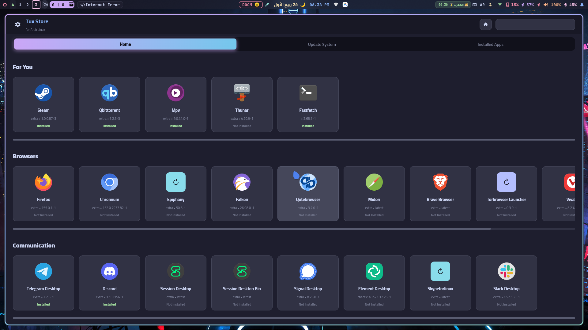
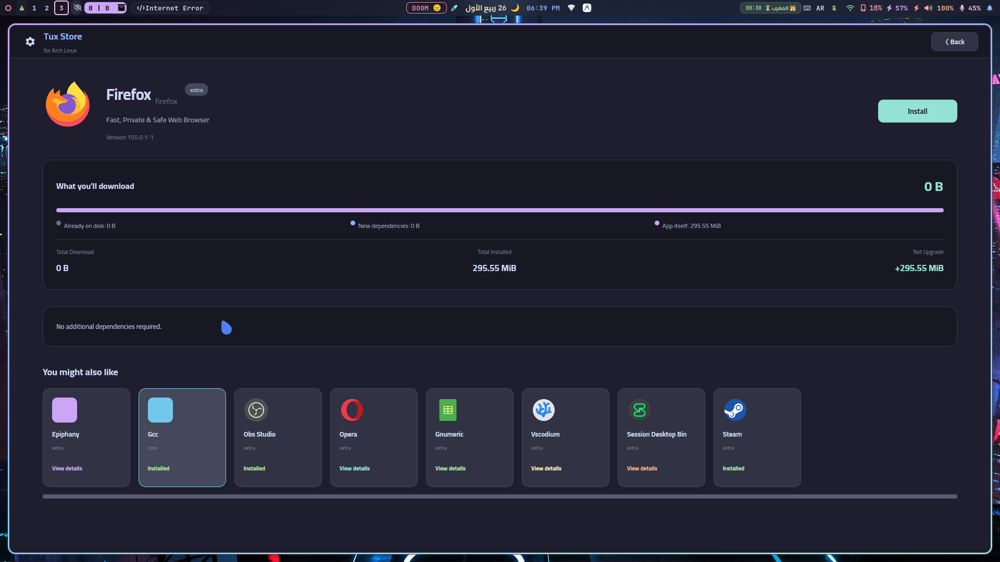
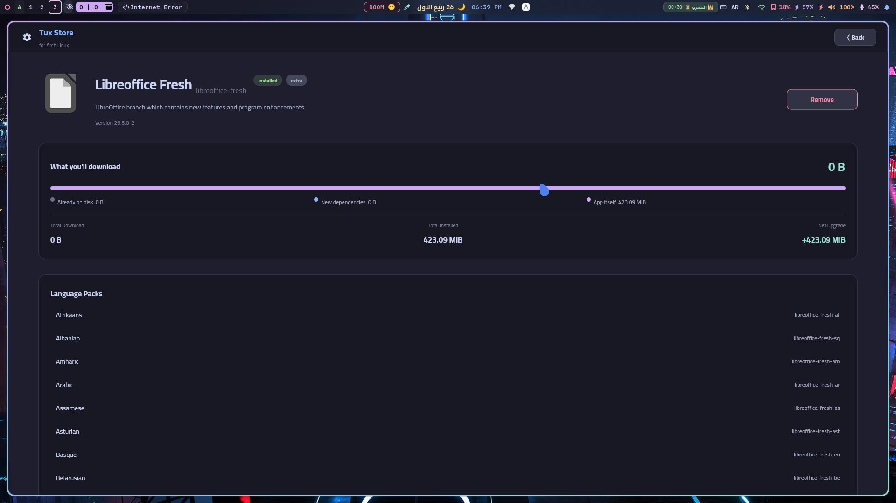
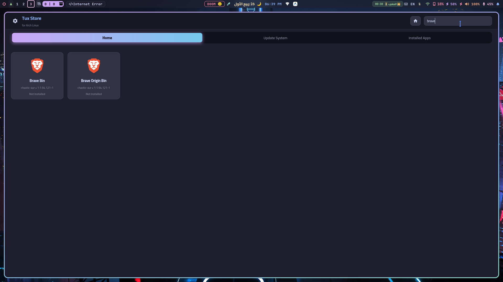
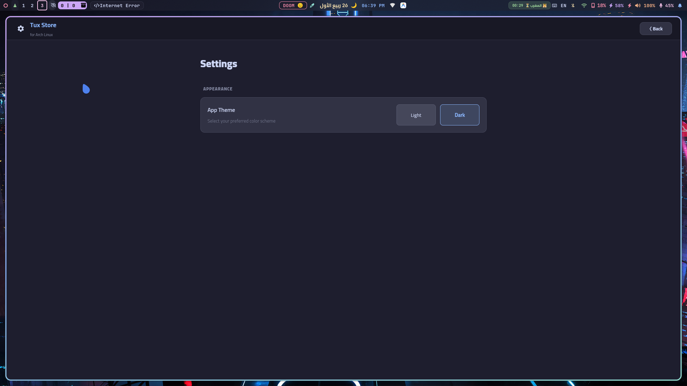
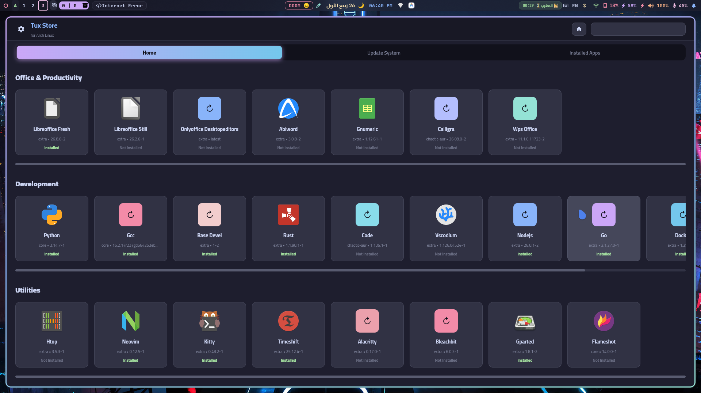

[🇬🇧 English](README.md)

<div dir="rtl">

# Tux Store

متجر برمجيات خفيف وأصلي لنظام **Arch Linux**، مكتوب بلغة **Rust** وواجهته بـ **Slint**. يغلّف `pacman` بتجربة تشبه متاجر التطبيقات: تطبيقات مختارة، بحث، تفاصيل حقيقية للاعتماديات والأحجام قبل التثبيت، وشريط تقدّم حيّ يتبع مراحل pacman الفعلية.


## لقطات الشاشة

</div>

<table>
  <tr>
    <td align="center">
      <div>
        
        <div><strong>الصفحة الرئيسية</strong></div>
      </div>
    </td>
    <td align="center">
      <div>
        
        <div><strong>تفاصيل الحزمة</strong></div>
      </div>
    </td>
  </tr>
  <tr>
    <td align="center">
      <div>
        
        <div><strong>حزمة مع إضافات اللغات</strong></div>
      </div>
    </td>
    <td align="center">
      <div>
        
        <div><strong>البحث عن حزمة</strong></div>
      </div>
    </td>
  </tr>
  <tr>
    <td align="center">
      <div>
        
        <div><strong>الإعدادات</strong></div>
      </div>
    </td>
    <td align="center">
      <div>
        
        <div><strong>التصنيفات</strong></div>
      </div>
    </td>
  </tr>
</table>

<div dir="rtl">

## كيف يُبنى

ناتج البناء ملف تنفيذي صغير حوله مكتبات مشتركة (`.so`). لا تنادي المكتبات بعضها مباشرة، بل تتخاطب عبر ناقل رسائل واحد:

</div>

```
target/release/
├── tux-store              الملف التنفيذي (بلا منطق تطبيق)
├── libtux_ui.so           الواجهة (Slint)
├── libtux_search.so       الكتالوج والبحث والتفاصيل وقوائم المثبّت والتحديثات
├── libtux_thumbnail.so    الأيقونات وصور الأغلفة
└── libtux_install.so      عمليات pacman بصلاحيات root
```

<div dir="rtl">

التفاصيل في [DOCS/ARCHITECTURE.md](DOCS/ARCHITECTURE.md).

## المميزات

- **صفحة رئيسية منسّقة** — أقسام تُقرأ من `data/categories.json` مع شريط أغلفة في الأعلى.
- **تصنيفات ومجموعات ومستودعات** — تُكتشف من AppStream و`pacman` على جهازك، مع دمج المجموعات المتقاربة.
- **إخفاء الحزم** — اكتب أسماء الحزم في `hidden_packages.json` لتختفي من البحث والرئيسية والتصنيفات والمجموعات والمستودعات.
- **بحث فوري** أثناء الكتابة، مع ترتيب النتائج وتقسيمها إلى صفحات.
- **تفاصيل حقيقية للأحجام** — الاعتماديات والأحجام تأتي من محلّل pacman نفسه (`pacman -Sp`).
- **شريط تقدّم موزون** يتبع مراحل التنزيل ثم التحقق ثم التثبيت، ولا يعرض 100% قبل أن ينتهي pacman فعلاً.
- **تبويب المثبّتة** — الحزم التي ثبّتّها صراحةً، مع فلتر.
- **تبويب التحديثات** — قائمة الترقيات المعلّقة (عبر `checkupdates` إن وُجد) وزر **Update all**.
- **خمسة أنماط للحذف** — من الحذف البسيط إلى التنظيف الكامل.
- **إضافات وحزم لغات** من ملفات `data/special_case_packages/*.json`، وإضافات تفاعلية تظهر في التصنيفات عبر `"category"`.
- **أيقونات ذكية** — الكاش ثم الأيقونات المضمّنة ثم ثيم النظام ثم طلب واحد من Papirus، مع كاش للفشل.
- **زر رجوع** يعيدك عبر الحزم التي فتحتها من الاقتراحات والإضافات.
- **ثيم داكن/فاتح** يُحفظ بين التشغيلات.

## المتطلبات

- Arch Linux مع `pacman` و`polkit` (لـ `pkexec`) و`util-linux` (لأمر `script`).
- اختياري: `pacman-contrib` لفحص التحديثات بأمان.
- للبناء: `rust` و`base-devel` و`fontconfig` و`libxkbcommon` و`libglvnd`.

## التثبيت

**من إصدار جاهز** (صفحة Releases):

</div>

```bash
sudo pacman -U tux-store-<version>-1-x86_64.pkg.tar.zst
# أو النسخة المحمولة، تعمل من مكانها:
tar xzf tux-store-<version>-x86_64-linux.tar.gz
./tux-store-<version>/tux-store
```

<div dir="rtl">

**من المصدر:**

</div>

```bash
cargo build --release          # يبني الملف التنفيذي وكل مكتبات libtux_*.so
./target/release/tux-store
```

<div dir="rtl">

للتثبيت في النظام: `sudo make install` أو `cd packaging && makepkg -si`.

> ملاحظة: الأمر `cargo run` وحده لا يكفي، لأنه يبني الملف التنفيذي فقط دون المكتبات. استخدم `cargo build --release` أولاً.

## الاستخدام

</div>

```bash
tux-store                          # تشغيل المتجر
tux-store openpackage firefox      # فتح صفحة حزمة مباشرة
TUX_LOG=debug tux-store            # سجل مفصّل (error|warn|info|debug|trace)
```

<div dir="rtl">

| المتغيّر | الوظيفة |
|---|---|
| `TUX_LOG` | مستوى السجل |
| `TUX_MODULE_DIR` | مكان البحث عن `libtux_*.so` |
| `TUX_DATA_DIR` | مكان `categories.json` والأيقونات والأغلفة |

الإعدادات والكاش: `~/.config/tux-store/` و`~/.cache/tux-store/`.

## التوثيق

كل التفاصيل في مجلد [DOCS/](DOCS/README.md): البنية، وناقل الرسائل، وطبقة pacman، والمثبّت، والأيقونات، والواجهة، والإضافات، والإصدارات، والمساهمة.

## المساهمة

اقرأ [DOCS/CONTRIBUTING.md](DOCS/CONTRIBUTING.md). الإصدارات يبنيها الملف `.github/workflows/release.yml` ([DOCS/RELEASING.md](DOCS/RELEASING.md)).

## الرخصة

GPL-3.0-or-later — انظر [LICENSE](LICENSE).

</div>